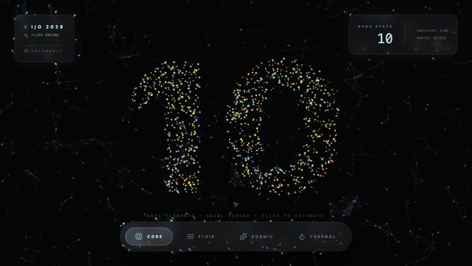
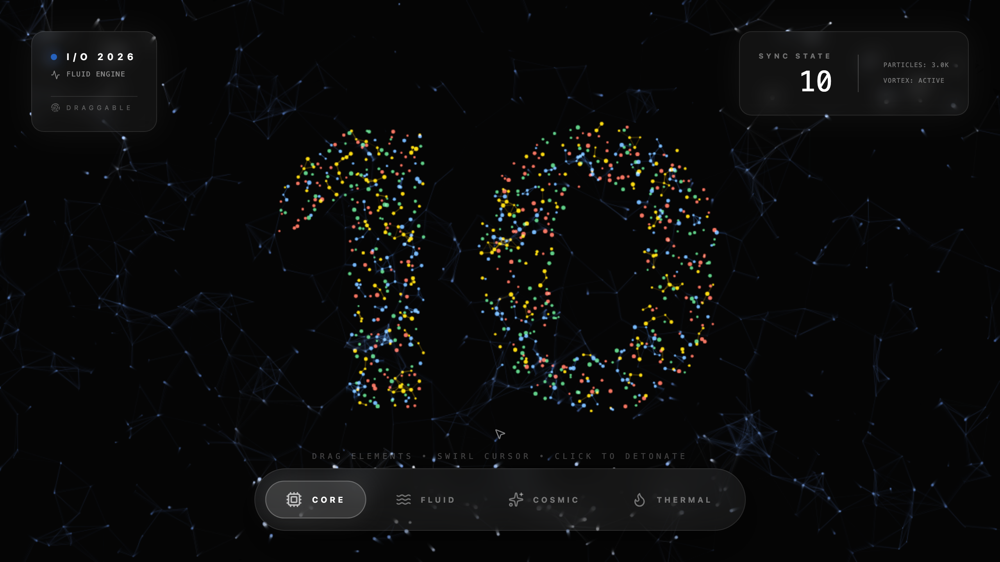
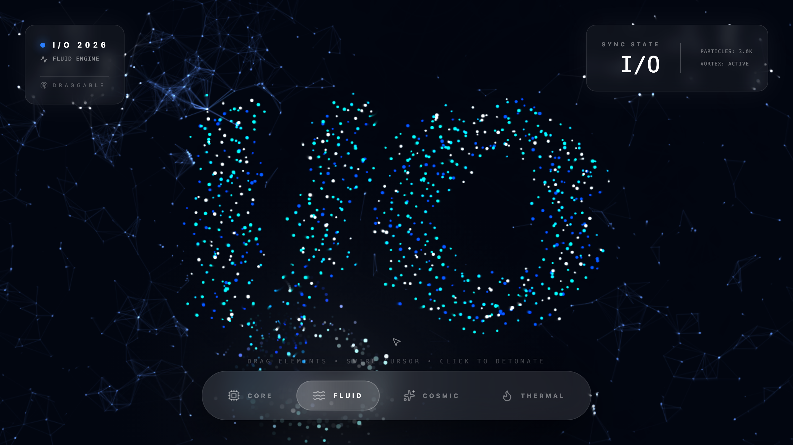
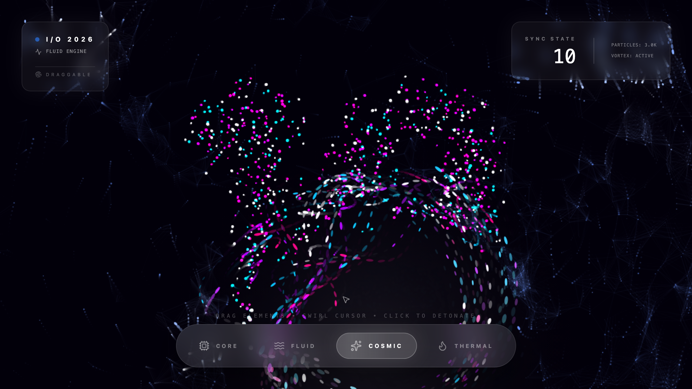

<div align="center">



# Prompt-Driven Physics Timer

A particle physics engine that counts down to Google I/O — 3,000 particles forming numbers, scattering explosively between transitions, and reforming into the next digit. Built to celebrate the final 10 days before I/O 2026.

</div>



## How It Works

Watch the countdown. The particles form each number from 10 down to 1, then spell "I/O" — each transition detonates the current shape into chaos before the particles magnetically reassemble. Move your cursor to create a vortex that swirls nearby particles. Click anywhere to trigger an explosive burst. The glassmorphic HUD panels are draggable and create fluid wakes in the particle field as you move them.

Four physics modes transform the particle behavior:

- **Core** — Google-colored particles with plexus connections, standard tracking
- **Fluid** — SPH fluid dynamics with buoyancy, currents, and wave motion
- **Cosmic** — Orbital mechanics with galactic swirl and lazy convergence
- **Thermal** — Rising flames with ember recycling and heat shimmer

<div align="center">

| | |
|---|---|
|  |  |
| **Fluid** — SPH water simulation | **Cosmic** — Orbital dynamics |

</div>

## Quick Start

```bash
git clone https://github.com/yourusername/ais-prompt-driven-physics-timer.git
cd ais-prompt-driven-physics-timer
npm install
npm run dev
```

Open [localhost:3000](http://localhost:3000). No API keys needed — it's entirely client-side.

## Tech Stack

| Layer | Technology |
|-------|-----------|
| Framework | React 19 + Vite 6 |
| Rendering | HTML5 Canvas 2D (CPU-driven) |
| Physics | Custom N-body with spatial grid, SPH fluid dynamics |
| Animation | Motion (Framer Motion) for UI transitions |
| Styling | Tailwind CSS v4 |
| Icons | Lucide React |
| Language | TypeScript |

## Architecture

The entire physics engine lives in a single `App.tsx` — a monolithic ~700-line component that handles:

- **Typography → Particles**: Rasterizes text to an offscreen canvas, samples lit pixels as particle targets
- **Spatial Grid**: O(n) neighbor lookup via cell-based spatial hashing (30-40px cells)
- **N-body Interactions**: Plexus connections between nearby same-color particles, SPH pressure forces in Fluid mode
- **UI Refraction**: DOM elements tagged with `data-ui-element` are tracked in the physics loop — particles glow near HUD edges and get pushed by drag wakes
- **Vortex Cursor**: Mouse position creates a tornado-like swirl with mode-specific push/pull behavior

## Context

This was a vibe-coded project for Google I/O 2026 — a visual 10-day countdown timer. The name "Prompt-Driven Physics Timer" reflects an aspirational AI-integration concept (using Gemini to control particle behavior via text prompts) that was never implemented. What shipped is the particle countdown engine itself, which turned out to be the interesting part anyway.

The countdown auto-advances every 6 seconds and loops: 10 → 9 → 8 → ... → 1 → I/O → 10.

## License

Apache-2.0
